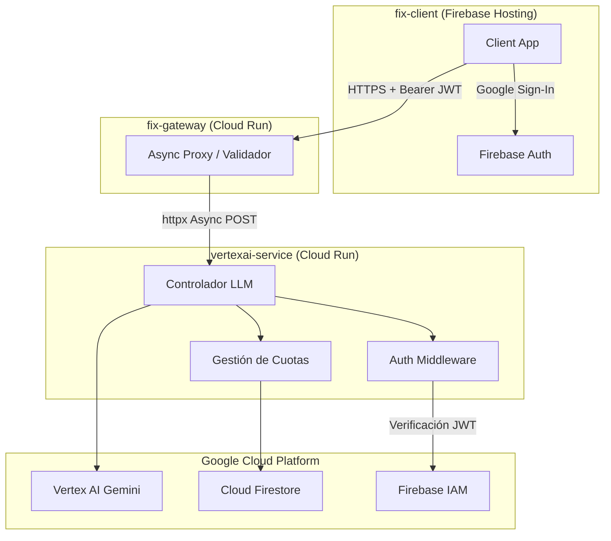

# Fix - Asistente de Soporte Técnico

## Descripción General

Fix es un sistema de asistencia técnica basado en Modelos de Lenguaje Grande (LLMs). La solución está diseñada bajo un patrón de microservicios, desplegada en Google Cloud Platform (GCP). Su objetivo principal es procesar consultas técnicas de usuarios autenticados, aplicando control de estado, limitación de cuotas y persistencia de historial.

## Arquitectura del Sistema

El pipeline de ejecución se divide en tres componentes aislados que interactúan de forma asíncrona:

1. **Cliente (`fix-client`)**: Single Page Application (SPA) encargada de la capa de presentación y el manejo de sesión en el navegador. Utiliza Firebase Auth para la emisión de tokens JWT.
2. **API Gateway (`fix-gateway`)**: Componente intermediario (proxy inverso) que recibe el tráfico público. Valida los esquemas de las peticiones HTTP y enruta el tráfico hacia el microservicio principal, ocultando su exposición directa.
3. **Microservicio Central (`vertexai-service`)**: Núcleo lógico del sistema. Sus responsabilidades incluyen:
   - Verificación estricta de firmas JWT de Firebase Auth.
   - Auditoría de consumo de cuotas mediante transacciones en Cloud Firestore.
   - Orquestación de llamadas a la API de Vertex AI (Gemini) para la inferencia del modelo.



## Stack Tecnológico

### Frontend (`fix-client`)
- **Lenguajes:** HTML5, CSS3, Vanilla JavaScript.
- **Dependencias externas:** Firebase JS SDK (compat), `marked.js` (parseo Markdown), `DOMPurify` (prevención XSS), `highlight.js` (resaltado de sintaxis).
- **Infraestructura:** Firebase Hosting.

### API Gateway (`fix-gateway`)
- **Entorno:** Python 3.11, Django 6 (ejecución asíncrona vía ASGI).
- **Dependencias clave:** `httpx` para peticiones I/O no bloqueantes, `pydantic` para validación de payloads.
- **Infraestructura:** Google Cloud Run, Uvicorn.

### Microservicio Central (`vertexai-service`)
- **Entorno:** Python 3.11, Django 6 (ASGI).
- **Dependencias clave:** `google-cloud-aiplatform` (SDK Vertex AI), `firebase-admin` (SDK Server-side).
- **Infraestructura:** Google Cloud Run. Requiere roles IAM para invocación de Vertex AI y Cloud Datastore.

## Instrucciones de Despliegue

Los servicios backend están preparados para ser construidos y desplegados directamente desde el código fuente a Google Cloud Run utilizando Buildpacks. Se debe respetar el siguiente orden estricto de despliegue:

### 1. Despliegue del Servicio Central (`vertexai-service`)
El core debe desplegarse primero para generar la URL que consumirá el API Gateway.

```bash
cd vertexai-service/django_microservice
gcloud run deploy vertexai-service --source . --region us-central1 --allow-unauthenticated
```
*(Es mandatorio configurar los roles adecuados en la Service Account asociada en GCP para el correcto funcionamiento de Firestore y Vertex AI).*

### 2. Despliegue del API Gateway (`fix-gateway`)
El Gateway requiere la inyección de la URL obtenida en el paso 1 a través de la variable de entorno `MICROSERVICE_URL`.

```bash
cd fix-gateway/django_gateway
gcloud run deploy fix-gateway --source . --region us-central1 --set-env-vars MICROSERVICE_URL=https://<URL_DE_VERTEXAI_SERVICE>.run.app --allow-unauthenticated
```

### 3. Despliegue del Cliente (`fix-client`)
El cliente asume que la URL del Gateway está pre-configurada en su código fuente (`app.js`).

```bash
cd fix-client
firebase deploy --only hosting
```

